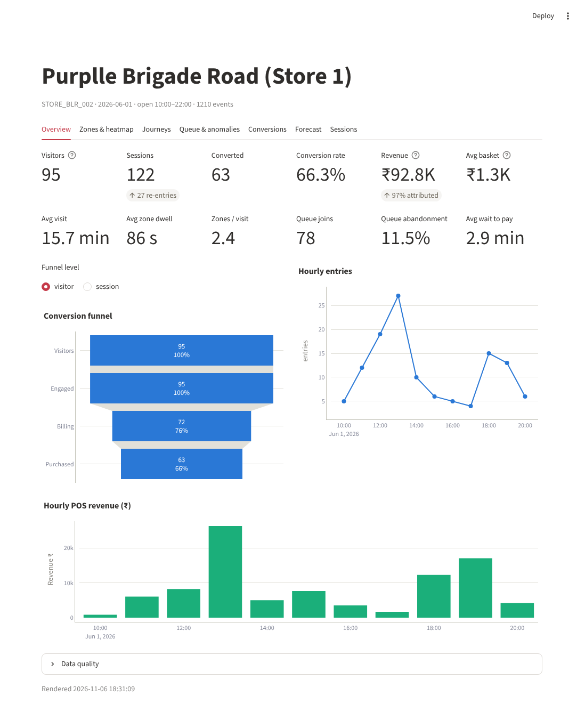
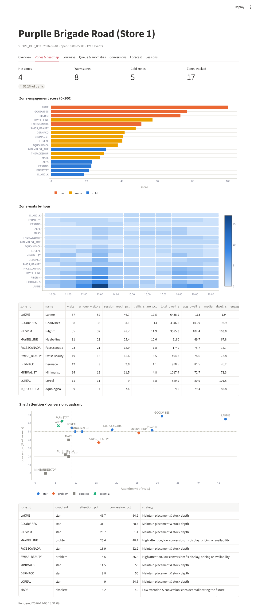
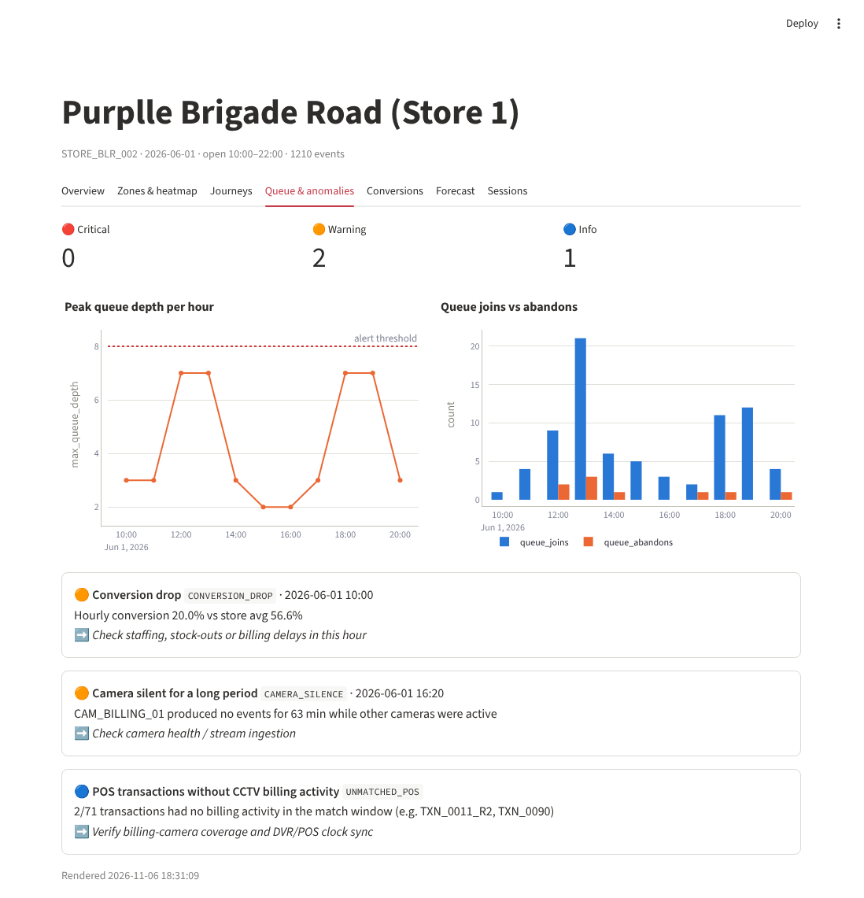
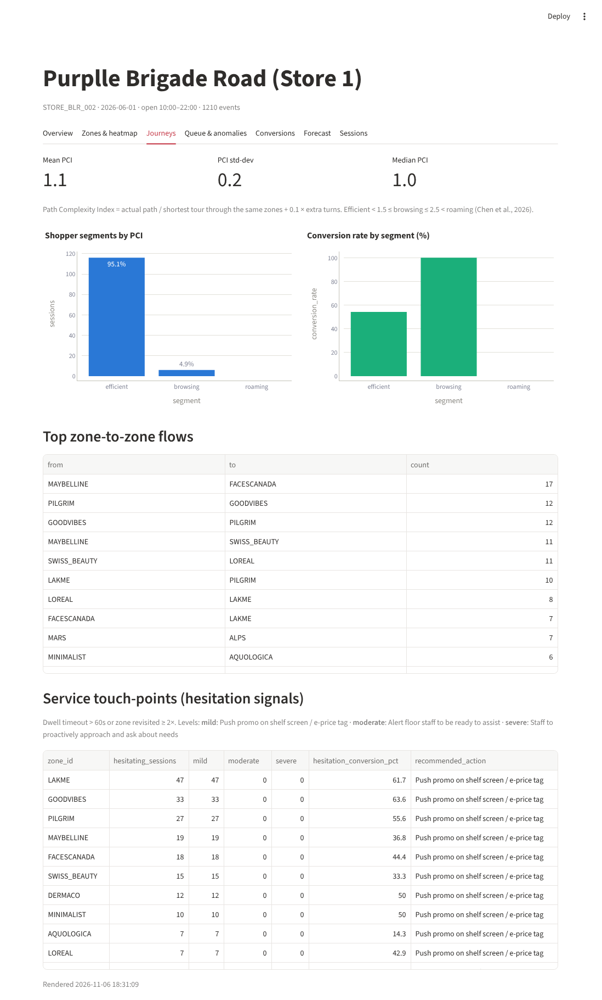

# Analytic Insights for Retail Store

An end-to-end **store intelligence platform**. It takes CCTV footage and POS transactions and turns customer movement into measurable business results: visitors, conversion, revenue attribution, zone engagement, queue health, shopper journeys and anomalies, all shown on a live dashboard.

```
Raw CCTV ─▶ YOLO11m + ByteTrack ─▶ Structured events ─▶ Session engine ─▶ POS correlation ─▶ Dashboard
 (CAM1-5)    (+ OSNet Re-ID on CAM3)   (JSONL, schema-checked)  (ENTRY→zones→EXIT)  (±5 min billing)    (Streamlit)
```

---

## Quick start

```bash
pip install -r requirements.txt
python scripts/seed_demo.py --reset          # loads the bundled dataset into SQLite
uvicorn app.main:app --port 8000             # REST API  → http://localhost:8000/docs
API_URL=http://localhost:8000 streamlit run dashboard/streamlit_app.py --server.port 8501
python -m pytest                             # 22 tests
```

Or with Docker: `docker compose up --build`. The API runs on `:8000` and the dashboard on `:8501`.

To process real video you also need `pip install -r requirements-pipeline.txt` (Ultralytics YOLO11m/ByteTrack and OpenCV; OSNet through torchreid is optional).

| Overview | Zones & heatmap |
|---|---|
|  |  |
| **Queue & anomalies** | **Journeys (PCI, hesitation)** |
|  |  |

---

## Architecture (six layers)

| Layer | What it does | Code |
|---|---|---|
| **Input** | CCTV clips (CAM1/2 shelves, CAM3 doorway, CAM5 billing) and the Brigade POS CSV | `data/`, `config/store_layout.json` |
| **Ingestion** | YOLO11m person detection, ByteTrack IDs, per-camera rules, schema-validated events. The POS loader aggregates item lines into invoices in Purplle format. The bridge posts both to `/events/ingest` and `/pos/ingest` | `pipeline/` |
| **Data** | SQLite tables `events` and `pos_transactions`, **idempotent** on `event_id` and on `(store_id, transaction_id)` | `app/db.py` |
| **Analytics** | Session builder first, then metrics, funnel, heatmap, anomalies, journeys and forecast, all **derived at query time** | `app/analytics/` |
| **API** | FastAPI REST contract usable by any client | `app/main.py` |
| **Presentation** | Streamlit dashboard. It never touches the DB and talks only HTTP | `dashboard/streamlit_app.py` |

See [`docs/architecture.md`](docs/architecture.md) for the camera processor map, the event schema and the algorithms.

### Design principles
- **Event-driven:** raw events are stored and sessions are rebuilt on read, so results are auditable and can be replayed.
- **Session-centric:** ENTRY or REENTRY opens a visit and EXIT closes it. Zone and queue events attach only to an open session. Anything else is counted as an *orphan* and reported as a data-quality signal.
- **CCTV and POS linked:** a visitor counts as converted when they had billing activity within 5 minutes before a POS timestamp. Matching is one-to-one and FIFO.
- **Visitor-level funnel:** a REENTRY opens a new session but does not double-count the unique visitor.
- **Separation of concerns:** vision lives in `pipeline/`, intelligence in `app/`, and the UI only calls HTTP.

---

## Camera processors

| Camera | Processor | Logic | Events |
|---|---|---|---|
| CAM1 – Left shelf | `cam1` → `ZoneDwellProcessor` | Zone polygons with debounced enter (1 s) and exit grace (1.5 s) | `ZONE_ENTER`, `ZONE_DWELL`, `ZONE_EXIT` |
| CAM2 – Right shelf | `cam2` → `ZoneDwellProcessor` | Same as CAM1 | `ZONE_*` |
| CAM3 – Doorway | `EntryExitProcessor` | Entry-line half-plane crossing plus OSNet Re-ID gallery (`ReIDManager` + `SessionStore`) | `ENTRY`, `EXIT`, `REENTRY` |
| CAM5 – Billing | `QueueProcessor` | Queue polygon (join after 3 s, abandon if the shopper leaves without paying) plus a payment polygon | `BILLING_QUEUE_JOIN` (with `queue_depth`), `BILLING_QUEUE_ABANDON`, `ZONE_*` with `PAYMENT` |

Tracks present for at least 90% of a clip of 90 s or more (cashier, floor staff) are flagged `is_staff=true` and excluded from the KPIs.

```bash
python -m pipeline.run_pipeline --store-id STORE_BLR_002 --camera CAM3 \
    --video videos/cam3.mp4 --start-time 2026-04-10T20:10:00Z \
    --reid-gallery reid_gallery.json --debug-video cam3_debug.mp4 --post http://localhost:8000
python -m pipeline.pos_loader data/pos/brigade_bangalore_10_april_26_anonymised.csv --out-dir data/pos
python -m pipeline.bridge events data/pipeline_outputs --api http://localhost:8000
```

`--debug-video` draws the zones, lines and tracks over the clip. Use it to re-calibrate the polygons in `config/store_layout.json`, which are normalised `[0..1]` image coordinates.

---

## API

All analytics endpoints take `store_id`, plus an optional `date=YYYY-MM-DD` or `start`/`end`, and an optional `window_before_min`/`window_after_min` to tune POS matching.

| Method | Route | Returns |
|---|---|---|
| POST | `/events/ingest` | `{received, inserted, duplicates, rejected, errors[]}`. Records are validated one at a time, so one bad record does not fail the batch |
| POST | `/pos/ingest` | Same, for POS transactions |
| GET | `/stores`, `/stores/{id}/layout` | Stores, the dates that have data, and the layout |
| GET | `/metrics` | Visitors, sessions, conversion rate, revenue (total and attributed), dwell, queue KPIs, data quality |
| GET | `/funnel?level=visitor\|session` | Visitors → Engaged → Billing → Purchased, with drop-off |
| GET | `/heatmap` | Per zone: visits, dwell, engagement score (0–100), hot/warm/cold class; plus an hour × zone matrix |
| GET | `/anomalies` | Typed anomalies with severity, evidence and a suggested action |
| GET | `/timeseries` | Hourly entries, queue, revenue and conversion |
| GET | `/sessions`, `/sessions/{id}` | Session list and full journey with raw events |
| GET | `/conversions` | POS ↔ session matches with gap and confidence |
| GET | `/insights/journeys` | Path Complexity Index, shopper segments, top zone-to-zone flows |
| GET | `/insights/hesitation` | Service touch-points: hesitation levels per zone and the recommended staff action |
| GET | `/insights/shelf` | Attention × conversion quadrant (star / problem / potential / obsolete) |
| GET | `/forecast?horizon=6` | Footfall forecast (damped Holt, open hours only) and the CCTV+POS fusion regression |

---

## Research foundations

| Paper | What we use |
|---|---|
| Chen et al., *Customer movements… multi-target tracking* (Procedia CS 281, 2026) | YOLO + **ByteTrack** + **OSNet** Re-ID. **Hot/warm/cold zones** (high traffic with above-median dwell / moderate / low or zero). **Path Complexity Index** with the efficient (<1.5), browsing (1.5–2.5) and roaming (>2.5) segments. **Hesitation signals** (dwell >60 s, revisits ≥2) with tiered interventions. **Attention × conversion shelf quadrant**. 5 fps keyframe processing. |
| Deepa G et al., *Forecasting demand from video and transaction data* (ICDSAAI 2026) | **Multimodal fusion** of CCTV signals (footfall, dwell, queue) with POS revenue, and footfall **forecasting**. We use damped Holt smoothing, not an LSTM, because there is only one day per store; the forecast interface takes a sequence model once weeks of data exist. |

**Adaptation:** our events are zone-level, not continuous coordinates. PCI is therefore computed on the polyline entrance → visited zone centroids (`floor_xy`) → checkout, measured against the *shortest tour through the same zones*. The paper's straight entrance-to-checkout baseline would label every wall-shelf shopper "roaming".

---

## Dataset & results

| File | Content |
|---|---|
| `data/synthetic/store_{1,2}/` | Synthetic events (1,210 + 1,877) and POS (71 + 100) for STORE_BLR_002 and STORE_BLR_003 |
| `data/pipeline_outputs/` | Real pipeline output from the 2-minute demo clips (CAM1/CAM2/CAM3) |
| `data/pos/` | Brigade Road POS for 10 April 2026, **anonymised** (no names; phone numbers replaced by a salted SHA-256 `customer_hash`), aggregated to 24 invoices worth ₹34,331.71 |
| `data/sample_events.jsonl` | 200 events made of complete visitor journeys, matching the output schema |

| Store / day | Visitors | Sessions | Converted | Conv. rate | Revenue | Matched POS | Queue abandon | Mean PCI |
|---|---|---|---|---|---|---|---|---|
| STORE_BLR_002 · 2026-06-01 | 95 | 122 | 63 | 66.3% | ₹92,800.68 | 69/71 | 11.5% | 1.10 |
| STORE_BLR_003 · 2026-04-10 | 161 | 194 | 90 | 55.9% | ₹88,496.83 | 98/100 | 22.2% | 1.12 |

The slide's demo validation (3 visitors, 3 sessions, 2 converted, 66.7%, ₹2,148.50) is reproduced exactly by `tests/test_api.py::test_demo_validation_metrics`.

Findings the platform surfaces on this data:
- Hot zones are 4 of 17 zones in Store 1 (LAKME, GOODVIBES, PILGRIM, FACESCANADA) and carry **52% of zone traffic**.
- "Browsing" shoppers (PCI 1.5–2.5) convert at **83–100%**, against about 50% for "efficient" shoppers.
- Store 2 hits a **queue depth of 12** (4 critical congestion hours) and a 22% abandonment rate. The system recommends opening an extra counter.
- MAYBELLINE and SWISS_BEAUTY (Store 1) fall in the **problem** quadrant: high attention, low conversion.
- For the real 10 April Brigade data, the demo clips cover 2 minutes at about 20:10, while all 24 POS invoices fall between 12:15 and 19:21. The platform therefore reports 0 matches and raises `UNMATCHED_POS`, `ORPHAN_EVENTS` and `CAMERA_SILENCE` rather than inventing conversions.

---

## Project layout

```
app/                 FastAPI + analytics (sessions, pos_match, metrics, funnel, heatmap,
                     anomalies, insights, forecast, timeseries)
pipeline/            tracking.py (YOLO11m+ByteTrack), reid.py (OSNet, ReIDManager, SessionStore),
                     processors/ (dwell, entry_exit, queue), emit.py, run_pipeline.py,
                     pos_loader.py, bridge.py
dashboard/           Streamlit app (HTTP only)
config/              store_layout.json — zones, camera polygons, floor coords, open hours
data/                bundled dataset (anonymised)
scripts/seed_demo.py load everything (direct DB or via API)
tests/               API, analytics and pipeline unit tests (synthetic tracks, no GPU needed)
```

## Privacy
- No face images or identities are stored. Re-ID keeps only appearance embeddings, and only in the optional local gallery.
- POS PII is stripped at load time (`pipeline/pos_loader.py`). The raw export is never committed.

## Configuration (env vars)
`DATABASE_URL`, `STORE_LAYOUT`, `MATCH_WINDOW_BEFORE_MIN` (5), `MATCH_WINDOW_AFTER_MIN` (1), `MIN_EVENT_CONFIDENCE` (0), `HESITATION_DWELL_S` (60), `SEVERE_HESITATION_DWELL_S` (180), `LOITER_REVISITS` (2), `QUEUE_DEPTH_ALERT` (8), `POS_HASH_SALT`, `API_URL` (dashboard).
